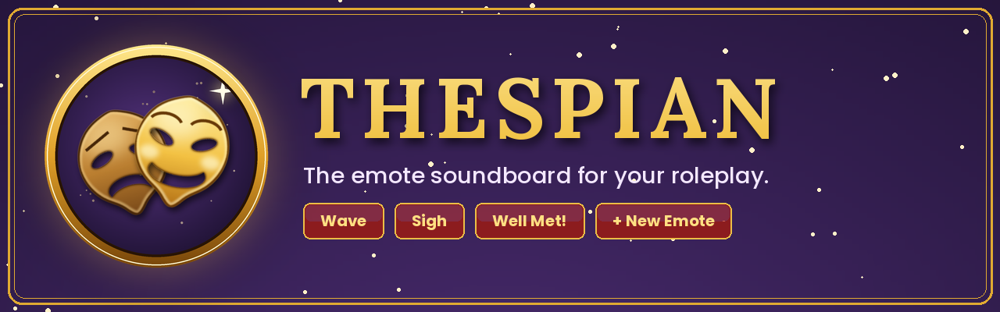
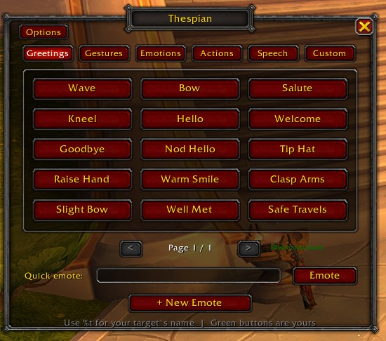
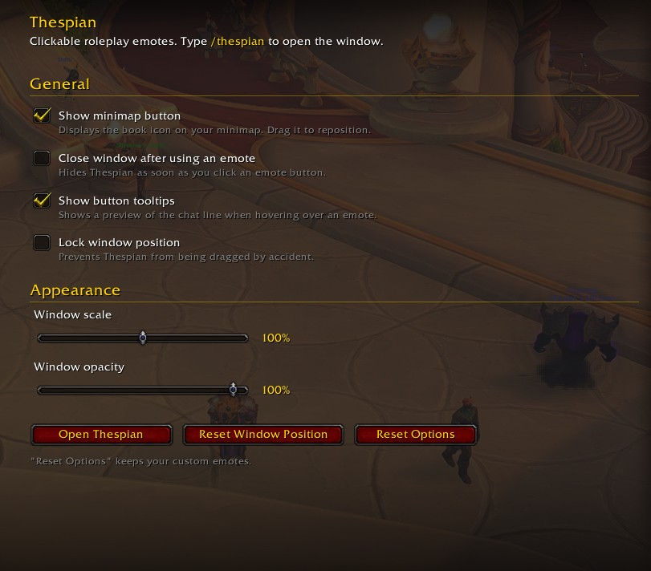

  

<h1 align="center">Thespian</h1>
<h3 align="center">The emote soundboard for your roleplay.</h3>

  <a href="https://www.curseforge.com/wow/addons/thespian"><b>Download on CurseForge</b></a> ·
  <a href="../../releases/latest">GitHub Releases</a> ·
  <a href="../../issues/new/choose">Report a bug</a>

  
  
  
  
  

---

Hit a button, play a beat.

**Thespian** turns your favourite roleplay lines and emotes into big, clickable buttons, like a soundboard, but for your character. Instead of retyping `/me strokes their chin thoughtfully.` for the hundredth time, you click once and get on with the scene.

Out of the box you get **70+ ready-made emotes**. When they aren't enough, build your own in a few seconds and they'll show up as buttons right next to the built-in ones.

## Why you'll like it

- **One click, one beat.** Greetings, gestures, emotions, actions and spoken lines are all a click away.
- **Your voice, your buttons.** Create custom emotes with their own label, channel and category.
- **Target-aware.** Write `%t` and Thespian swaps in your target's name, so `nods in greeting to %t.` becomes *"Uther nods in greeting to Arthas."*
- **Looks like it belongs in WoW.** Blizzard-style dialog frame, dark tooltip-style panels, gold accents, no foreign UI libraries.
- **Light and standalone.** One small addon, no dependencies, nothing running in the background.
- **Works everywhere.** Retail, Classic Era (including Hardcore and Seasonal), TBC Anniversary and Mists of Pandaria Classic, from the same download.
- **Never speaks for you.** Thespian only sends a message when *you* click a button or press Enter.

## Features

### The soundboard

Six tabs, 15 buttons per page:

| Tab | What's in it | Examples |
|---|---|---|
| **Greetings** | Hellos, goodbyes, salutes | Wave, Bow, Tip Hat, Clasp Arms, Well Met |
| **Gestures** | Body language | Cross Arms, Stroke Chin, Hand on Weapon, Raise Eyebrow |
| **Emotions** | Feelings you can *see* | Laugh, Sigh, Smirk, Tears Up, Tremble |
| **Actions** | Things your character *does* | Read Tome, Sharpen Blade, Study Map, Pour Drink |
| **Speech** | Spoken lines and OOC notes | Excuse Me, I Mean No Harm, To Arms!, `(( brb ))` |
| **Custom** | Whatever you invent | Anything you create |

Hover any button to preview exactly what will appear in chat.

### The emote builder

Click **+ New Emote** and pick:

| Type | Sends | Example |
|---|---|---|
| **Emote (/me)** | An emote line in orange | `raises a tankard in toast.` |
| **Say** | `/s` | `Well met, friend!` |
| **Yell** | `/y` | `Hold the line!` |
| **Party** | `/p` | `(( afk 2 min ))` |
| **Standard emote** | A built-in emote by token | `WAVE`, `BOW`, `LAUGH` |

You also choose which tab the button lives on, and a live **preview** shows you the chat line as you type. Your buttons are shown in green. **Right-click** one to edit or delete it.

### Quick emote

A text box at the bottom of the window sends anything you type as a `/me` emote. It's handy for the line that doesn't deserve its own button.

### Options

Open them from the **Options** button, the minimap button (right-click), `/thespian options`, or in the game's own settings under *AddOns → Thespian*:

- Show or hide the minimap button
- Close the window after using an emote
- Show or hide button tooltips
- Lock the window position
- Window scale (50%–150%) and opacity (40%–100%)
- Reset window position / reset options (your custom emotes are kept)

### Minimap button

A golden theatre mask on your minimap. Left-click opens the soundboard, right-click opens the options, drag to reposition. It also works with square minimaps, and on Retail you'll find Thespian in the addon compartment too.

<!--
SCREENSHOTS: add your own in docs/screenshots/ and uncomment.

## Screenshots

| The soundboard | The emote builder |
|---|---|
|  |  |

| Options | Minimap button |
|---|---|
|  |  |
-->

## Installation

**CurseForge app / site** (recommended): search for **Thespian** and install, or [download it here](https://www.curseforge.com/wow/addons/thespian).

**Manually:**

1. Download the latest zip from [GitHub Releases](../../releases/latest).
2. Extract the `Thespian` folder into the AddOns folder of the game version you play:

| Game version | Folder |
|---|---|
| Retail | `World of Warcraft/_retail_/Interface/AddOns/` |
| Forever | `World of Warcraft/_forever_/Interface/AddOns/` |
| Classic Era / Hardcore / Seasonal | `World of Warcraft/_classic_era_/Interface/AddOns/` |
| TBC Classic Anniversary | `World of Warcraft/_anniversary_/Interface/AddOns/` |
| Mists of Pandaria Classic | `World of Warcraft/_classic_/Interface/AddOns/` |

3. Restart the game (or `/reload`) and type `/thespian`.

## Quick start

1. Type **`/thespian`** (or click the minimap mask).
2. Pick a tab and click a button. That's it, you've emoted.
3. Want your own? Click **+ New Emote**, write it, hit **Save**.

### Using `%t`

| You write | You target | Chat shows |
|---|---|---|
| `nods in greeting to %t.` | Arthas | *Uther nods in greeting to Arthas.* |
| `glares at %t coldly.` | *(nobody)* | *Uther glares at someone coldly.* |

Standard emotes (`WAVE`, `BOW`, …) simply act on your current target, exactly like typing `/wave`.

## Commands

| Command | What it does |
|---|---|
| `/thespian` | Open or close the soundboard (aliases: `/rpe`, `/rpemotes`) |
| `/thespian options` | Open the options panel |
| `/thespian new` | Open the emote builder |
| `/thespian scale <0.5-1.5>` | Resize the window |
| `/thespian reset` | Put the window back in the centre of the screen |
| `/thespian minimap` | Show or hide the minimap button |

## Compatibility

| Game | Version | Interface |
|---|---|---|
| Retail | 12.0.x | 120000 – 120007 |
| Mists of Pandaria Classic | 5.5.x | 50503, 50504 |
| TBC Classic Anniversary | 2.5.x | 20504, 20505 |
| Classic Era (Hardcore, Seasonal) | 1.15.x | 11507 – 11509 |

The same Lua code runs on every version; only the interface numbers in the `.toc` differ. If WoW flags Thespian as out of date after a patch, tick **Load out of date AddOns**, or run `/dump select(4, GetBuildInfo())` and [open an issue](../../issues/new/choose) with the number.

## FAQ

**Does it send anything on its own?**
No. Nothing is sent unless you click a button or press Enter in the quick-emote box.

**Where are my custom emotes stored?**
In the addon's saved variables (`ThespianDB`), which are account-wide, so every character on your account shares them.

**Does it replace RP profile addons like Total RP 3?**
No, they do different jobs. Thespian is a soundboard for emotes and lines; it doesn't manage character profiles.

**Can I share my emotes with friends?**
Not yet. Import/export is on the wishlist (see below).

**My emote is cut off.**
WoW chat messages are limited to 255 characters. Thespian trims anything longer.

**Is the interface only in English?**
For now, yes.

## Wishlist

Ideas, not promises. Open an issue if one of them matters to you:

- Import / export of custom emotes
- Reorder buttons and drag-and-drop between tabs
- Optional keybindings for favourite emotes
- More built-in packs (tavern, combat, court, travel…)
- Localisation

## Contributing

Bug reports and ideas are welcome via [Issues](../../issues/new/choose). Pull requests too: the whole addon is a single readable Lua file. If you add presets, keep them neutral enough to fit any race, faction and class.

When reporting a bug, please include your game version (Retail / Classic Era / …), the addon version, and any Lua error text (BugSack or the in-game error popup).

## Credits & License

Made for the people who play their characters rather than just their rotations.

Released under the [MIT License](LICENSE). The icon and banner artwork were created for this project and are covered by the same license.
